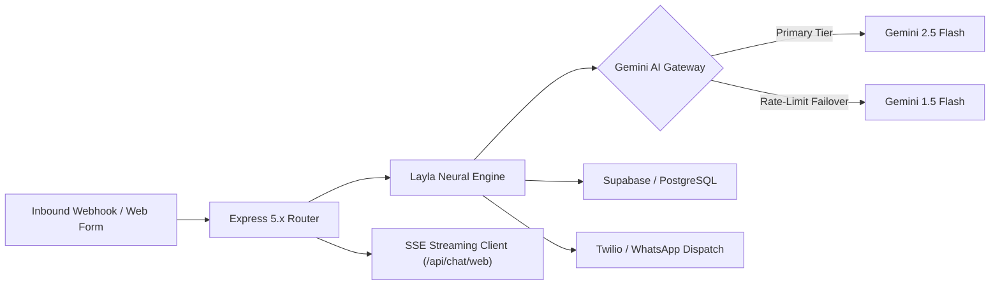

# ⚡ Speed To Lead™ — Autonomous Inbound Revenue Engine

Production inbound qualification pipeline and conversational closing engine powering [ainexlifyagencies.com](https://www.ainexlifyagencies.com). Compresses lead response times from 45+ minutes to <25 seconds with real-time multi-channel engagement.

---

## 🏛️ Architecture Overview



## 🛠️ Tech Stack & Production Components
* **Runtime & Routing:** Node.js / Express 5.x with catch-all edge serverless rewriting.
* **AI Orchestration:** Google Gemini 2.5 Flash with automated failover to Gemini 1.5 Flash on 429/503 rate limits.
* **Real-Time Streaming:** Server-Sent Events (SSE) via `/api/chat/web` delivering sub-1.5s initial token latency.
* **Data & Persistence:** Supabase PostgreSQL with Row-Level Security (RLS) for lead records, audit telemetry, and inventory caching.
* **Edge Hosting:** Vercel Production deployment aliased to `ainexlifyagencies.com`.

## 📡 Live Production Endpoints
* **Web Chat SSE Stream:** `POST https://www.ainexlifyagencies.com/api/chat/web`
* **Lead Qualification Webhook:** `POST https://www.ainexlifyagencies.com/api/contact`
* **Health & Latency Telemetry:** `GET https://www.ainexlifyagencies.com/health`

## 🔒 Security & Reliability Guards
* **Rate Limiting:** IP-based sliding window limiter via `express-rate-limit`.
* **Model Failover:** Graceful error handling and retry backoff preventing user drop-off during peak traffic.
* **Credential Isolation:** Strict `.gitignore` preventing all `.env.vercel*` secrets from git history.

---

## 🚀 Local Development

1. **Install Dependencies:**
   ```bash
   cd server
   npm install
   ```

2. **Configure Environment:**
   Create `server/.env` based on required production credentials:
   ```env
   GEMINI_API_KEY=your_gemini_api_key
   SUPABASE_URL=your_supabase_url
   SUPABASE_SERVICE_ROLE_KEY=your_service_role_key
   TWILIO_ACCOUNT_SID=your_twilio_sid
   TWILIO_AUTH_TOKEN=your_twilio_token
   PORT=3001
   ```

3. **Run Server:**
   ```bash
   node index.js
   ```

---
*Engineered by Anas Wahab • [AI Nexlify Agencies](https://www.ainexlifyagencies.com)*
